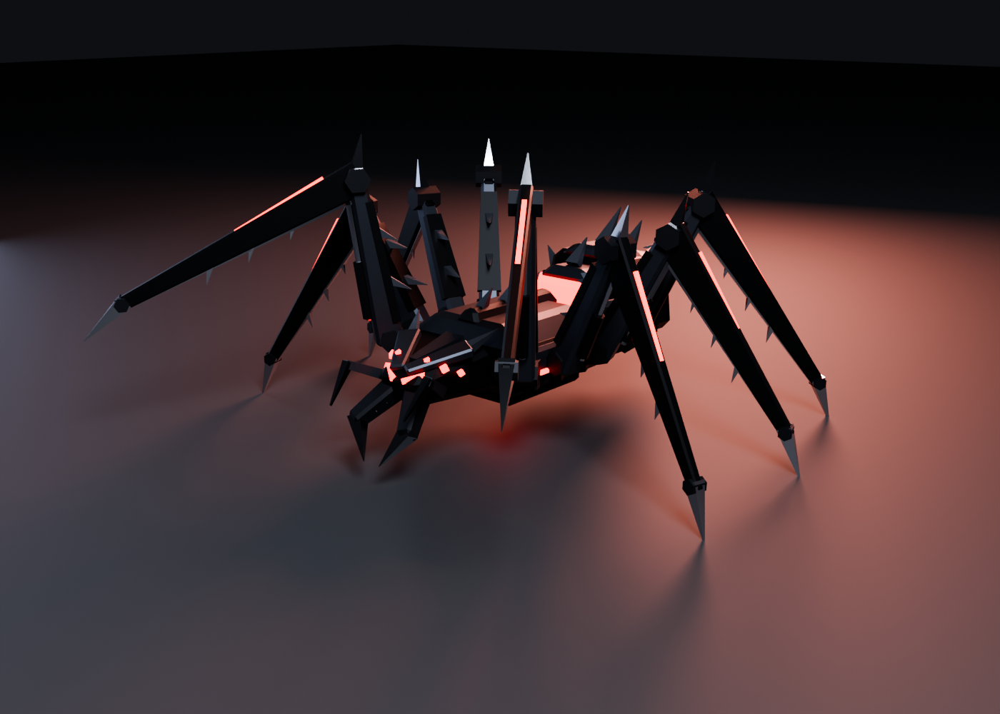

# Game Models

Low-poly, Synty-style 3D models for Unity, each one rigged, animated and generated from a script, so it can be rebuilt or tweaked at any time.

## Catalog

| Model | Preview | What it is | Tris | Clips |
|---|---|---|---|---|
| [ARC-8 "Reaper" Crawler](models/arc8-reaper/) |  | Hostile mech spider: blade legs, serrated fangs, glowing core. 3 color schemes. | 4.4k | Idle, Walk, Run, Threat, Attack, Hit, Death |

## Demos

| Demo | What it shows |
|---|---|
| [Reaper Containment](demos/reaper-containment/) | Browser demo: the Reaper roams a test chamber with procedural foot IK, A* pathfinding, and lure and stalk hunting. Open `index.html` in a browser. |

## Layout

```
models/<model-name>/
  <Model>.fbx         Unity-ready mesh + rig + animations
  <Model>.blend       Blender source
  Textures/           palette atlases (albedo, emission, metallic/smoothness)
  Unity/              import settings, prefab builder, runtime controller
  Previews/           renders and GIFs
  source/             the Python scripts that generate the model
  README.md           specs, clips, Unity setup
demos/<demo-name>/    interactive web demos built from the models
```

## Rebuilding a model

The models are built with Blender's Python module (`pip install bpy`, Python 3.13 for Blender 5.x):

```bash
python3 models/arc8-reaper/source/build_spider.py          # writes .fbx, .blend and Textures/ next to source/
python3 models/arc8-reaper/source/render.py models/arc8-reaper/SpiderBot.blend models/arc8-reaper/Previews hero
```

## Unity

Copy a model folder into `Assets/`, then follow that model's README. Each one adds a **Tools** menu item that builds prefabs for Built-in, URP or HDRP.
