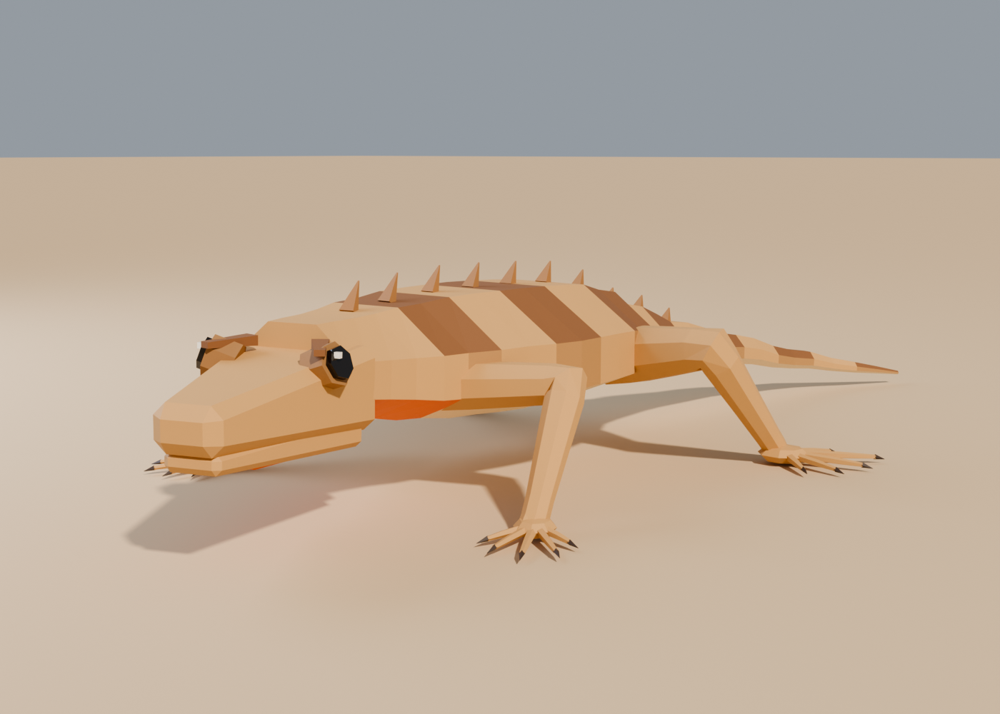
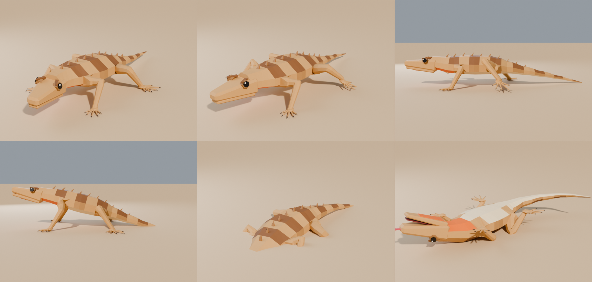
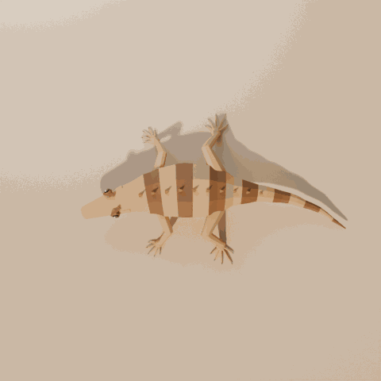

# Sand Lizard: low-poly desert critter for Unity

A small, flat-shaded desert lizard in a Synty-style look: banded back, dorsal crest, bright throat patch, splayed toes. One skinned mesh with a smoothly bending spine and tail, one palette-atlas material, 24-bone generic rig, 9 animation clips. Feet are placed with IK while the clips are generated, so they stay planted during walks, push-ups and the sand dive.

## Contents
| File | What it is |
|---|---|
| `SandLizard.fbx` | Mesh + rig + all animations (Unity-ready) |
| `SandLizard.blend` | Blender source (Blender 4.2+ / 5.x), all actions kept |
| `Textures/` | 256px palette atlases: **Desert** (tan, orange throat), **Dune** (pale ash, blue throat), **Ember** (red-black, yellow eyes), plus a shared smoothness map |
| `Unity/` | Import postprocessor, one-click prefab builder, animation driver, critter AI |
| `source/` | `build_lizard.py` generates everything above; `render_lizard.py` makes the previews |

## Specs
- ~2.5k triangles, 1.4k verts, 1 material, flat shading
- Size: 0.5 m nose to tail at scale 1. Scale the prefab freely; speeds and AI distances scale with it
- Spine, tail and limbs are smooth-skinned (limbs are continuous tubes that bend at elbow, knee and wrist); head, jaw and tongue are rigid
- Bones: `Root > Body > Chest > Neck > Head > Jaw, Tongue`, `Body > Hips > Tail1-4`, `Chest > UpperArm > Forearm > Hand` (L/R), `Hips > Thigh > Shin > Foot` (L/R)

## Animations (30 fps, in place)
| Clip | Frames | Loop | Notes |
|---|---|---|---|
| Idle | 120 | yes | breathing, snapping head looks with tilts, two tongue flicks, lazy tail tip |
| Walk | 24 | yes | diagonal trot with an S-wave through spine and tail, no slide at **0.101 m/s** |
| Run | 10 | yes | body raised, faster wave, no slide at **0.633 m/s** |
| PushUps | 45 | no | two territorial push-ups, then a tongue flick |
| Burrow | 36 | no | wiggles head-first into the sand; ends fully underground |
| Emerge | 36 | no | Burrow in reverse |
| Death | 40 | no | flips belly-up, legs curl, last twitches, tongue out |
| TurnLeft / TurnRight | 16 | yes | stepping pivot on the spot with the spine curved into the turn; no slip at **89.5°/s** |

## Unity setup (Built-in, URP or HDRP)
1. Copy the folder (FBX, `Textures/`, `Unity/`) into `Assets/`. Keep `Textures` next to the FBX.
2. The postprocessor sets the rig to **Generic**, renames clips (`SandLizard|Walk` → `Walk`) and makes Idle, Walk, Run and the turn clips loop.
   If you imported the FBX before the scripts, right-click it → **Reimport**.
3. Menu **Tools › Sand Lizard › Build Prefabs** creates materials for your render pipeline, `SandLizard.controller`
   (2D locomotion blend of Speed × Turn over Idle, Walk, Run, TurnLeft, TurnRight; PushUps trigger; Burrowed and Dead bools)
   and three prefabs in `Prefabs/`.
4. Drop a prefab on some ground with a collider and press Play. The lizard wanders, does push-ups, runs from the object tagged **Player** and dives into the sand when it gets cornered.

`SandLizardAI` settings: threat, notice / safe / panic distances, wander radius, idle and hide times, push-up and run chances, ground and obstacle layers. Call `Kill()` to kill it.

`SandLizardController` drives the Animator: `SetSpeed(mps)`, `PushUps()`, `Burrow()`, `Emerge()`, `Die()`.
Turning needs no call: it measures how fast the object yaws, plays the stepping turn clips paced to that rate
(faster pivots speed the clips up so the feet keep up), and bends the spine and tail into turns while moving (`turnBend`). Tick **Demo Input** to steer it yourself (WASD, Shift run, P push-ups, B burrow/emerge, K die). The AI pauses while Demo Input is on.

## Tips
- It is tiny at scale 1 (real-lizard size). For a more readable game critter, scale the prefab to 2–3.
- Want a new colour scheme? Edit an Albedo PNG; each 64px square is one colour. The texture uses point filtering so the colours stay crisp.
